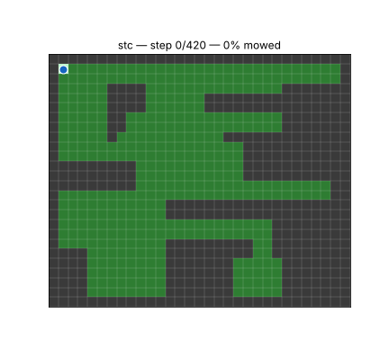
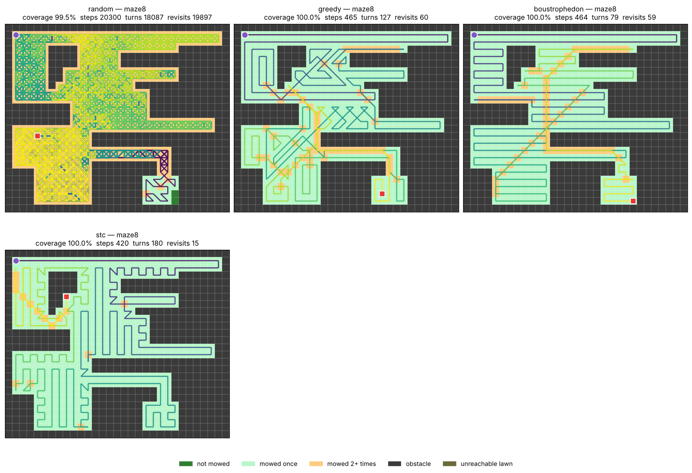

# Lawnmower — coverage path planning on a grid

Plan a path that mows every reachable cell of a lawn with as little wasted
travel as possible, compare planners on the same footing, and train
reinforcement-learning agents on the same model.



## Quick start

```bash
pip install -e .            # numpy + matplotlib
pip install -e '.[rl]'      # + gymnasium, for the RL environment
pip install -e '.[dev]'     # + pytest

python -m lawnmower run maps/maze8.txt -p stc --plot stc.png
python -m lawnmower run maps/maze7.txt -p greedy --ascii --gif greedy.gif
python -m lawnmower compare maps/maze6.txt maps/maze8.txt --plot compare.png
pytest
```

```python
from lawnmower import Lawn, plan

lawn = Lawn.from_file("maps/maze8.txt")          # or Lawn.from_string(...)
res = plan(lawn, "boustrophedon")
print(res.metrics.as_dict(), res.path[:5])
```

## The model

* One grid cell is exactly the area the blade cuts. The mower sits on one
  cell and mows it on arrival.
* It moves to any of its 8 neighbours per step. A diagonal move is only legal
  if both orthogonal cells it squeezes between are free — the mower never
  clips an obstacle corner.
* As a consequence, the lawn to mow is the 4-connected region around the
  start. Lawn cut off from it is reported as *unreachable* and excluded from
  coverage (see `maps/maze2.txt`).

Map files: `L` lawn, `S` lawn + start, `+` obstacle (`.` and `#` also work).
Without `S` the start is the first lawn cell in reading order; `--start ROW,COL`
overrides both.

Every planner just returns a list of cells. `lawnmower.sim.evaluate` replays
it, **rejects any illegal step**, and computes all metrics, so planners (and RL
agents) are always scored by the same rules:

| metric     | meaning |
|------------|---------|
| `coverage` | share of reachable cells visited |
| `steps`    | number of moves |
| `length`   | distance travelled (diagonal = √2) |
| `turns` / `turn_angle` | heading changes, and their total in degrees |
| `revisits` | moves landing on an already-mowed cell |
| `overhead` | `steps / (N − 1)`; 1.0 means no cell was visited twice |

### Lower bound and true optimum

With N cells to mow, the mower starts on one of them and each move reaches at
most one new cell, so **every complete path needs at least N − 1 moves**. A
path reaches this bound exactly when it never revisits a cell: it is then a
Hamiltonian path of the move graph starting at the start cell.

The true optimum is the shortest walk visiting every cell. Finding it
generalises the Hamiltonian path problem, which is NP-complete already on grid
graphs (Itai, Papadimitriou & Szwarcfiter, 1982), so it is not computed here.
`overhead` is therefore measured against the bound:

* a path with `overhead` 1.0 is **provably optimal**;
* above 1.0, part of the gap may be unavoidable — a dead-end corridor one cell
  wide, for instance, forces the mower to come back over cells it has mowed.

The bound ignores turns: two paths with the same number of steps can differ
a lot in how straight they are.

## Planners

| name | idea |
|------|------|
| `random` | Random walk preferring unmowed neighbours — the "bump-and-turn robot" baseline. Seeded; may stop before full coverage. |
| `greedy` | Keep straight while the cell ahead is unmowed, else take the unmowed neighbour needing the smallest turn (hugging the unmowed boundary); when boxed in, shortest path to the nearest unmowed cell. |
| `boustrophedon` | Boustrophedon cellular decomposition (Choset & Pignon 1997): split the lawn at obstacle "critical events" into cells that can each be mowed with straight back-and-forth passes, then sweep them. The cell order and entry corner is a small generalised TSP, solved by nearest-neighbour and by a rollout of it; vertical and horizontal passes are both tried. |
| `stc` | Spanning Tree Coverage (Gabriely & Rimon 2001): build a spanning tree on 2×2 blocks of lawn and walk around it, which visits every cell of those blocks exactly once. Strips the blocks miss (odd widths, obstacle edges) are mowed by short detours along the way. All 4 block alignments and 2 tree shapes are tried. |

`boustrophedon` and `stc` pick their best candidate on steps, then turns.
`--turn-weight W` charges each turn `W` steps instead, for mowers where
turning is slow.

### Results

`python -m lawnmower compare ...` (N = cells to mow):

| map (N) | planner | steps | turns | revisits | overhead |
|---|---|---:|---:|---:|---:|
| maze2 (404) | greedy | 457 | 133 | 54 | 1.13 |
| | boustrophedon | 443 | **71** | 40 | 1.10 |
| | stc | **427** | 182 | **24** | **1.06** |
| | random | 12 721 | 11 089 | 12 318 | 31.6 |
| maze8 (406) | greedy | 465 | 127 | 60 | 1.15 |
| | boustrophedon | 464 | **79** | 59 | 1.15 |
| | stc | **420** | 180 | **15** | **1.04** |
| test_map (347) | greedy | **440** | 173 | **94** | **1.27** |
| | boustrophedon | 442 | **167** | 96 | 1.28 |
| | stc | 478 | 283 | 132 | 1.38 |

STC wastes the fewest moves on open, blocky lawns; boustrophedon gives by far
the straightest passes; on a lawn peppered with single obstacles
(`test_map`) the simple greedy rule is as good as anything.
On an open rectangle both boustrophedon and STC are exact (no revisit).



## Reinforcement learning

`lawnmower.rl.LawnmowerEnv` is a Gymnasium environment on the same model
(also registered as `Lawnmower-v0`):

* **observation** `(4, H, W)` float planes — obstacles, mowed, mower, cell
  ahead (heading) — or an egocentric `(4, 2r+1, 2r+1)` window with
  `view_radius=r`, which lets one policy work across maps of any size;
  `turn_memory=True` adds a 5th plane, the steps since the last turn (see
  below);
* **action** `Discrete(8)`; illegal moves leave the mower in place and are
  penalised; `env.action_masks()` / `info["action_mask"]` give the legal ones
  (works with sb3-contrib `MaskablePPO`);
* **reward** `+1` per new cell, `−0.1` per step, `−0.05` per 45° turned,
  `−1` per illegal move, `+10` on completion — all set via `Rewards(...)`,
  which can also make consecutive turns cost more (`turn_repeat`, `turn_decay`);
* pass several lawns and/or `random_start=True` to train for generalisation;
* `env.result()` scores the episode with the same metrics as the planners, and
  `path_to_actions(planner_path)` turns any planner into expert
  demonstrations for imitation learning.

```python
from lawnmower import Lawn
from lawnmower.rl import LawnmowerEnv

env = LawnmowerEnv([Lawn.from_file(f"maps/maze{i}.txt") for i in (0, 3, 4, 7)],
                   view_radius=5, random_start=True)
obs, info = env.reset(seed=0)
obs, reward, terminated, truncated, info = env.step(env.action_space.sample())
```

No learning library is a dependency; plug in your own DQN / PPO / A2C.

## Learned agent

`lawnmower/learn/` trains an agent for this environment: behaviour cloning of
a planner, then PPO with action masking. Its paths go through the same
`evaluate` as the planners.

```bash
pip install -e '.[train]'
python -m lawnmower.learn train --out runs/small --size 8 14 --p-random 0.7 \
    --maps maps/maze3.txt maps/maze4.txt maps/maze5.txt maps/maze7.txt maps/maze7a.txt maps/maze7b.txt \
    --bc-teacher greedy --steps 1500000 --curriculum 0.3
python -m lawnmower.learn eval models/agent_small.pt maps/maze7.txt --random 100 --size 8 14 \
    --samples 16 --mcts 64

# run the agent like a planner (default model: models/agent_small.pt)
python -m lawnmower run maps/maze7.txt -p agent --gif agent.gif    # best of 16 sampled episodes
python -m lawnmower run maps/maze0.txt -p mcts --simulations 64    # MCTS guided by the network
python -m lawnmower compare maps/maze2.txt -p stc agent mcts
```

### Network

`CoverageNet` (`lawnmower/learn/net.py`) is fully convolutional:

```
observation (4, H, W)  obstacles · mowed · mower · cell ahead  (+ steps since last turn)
  └─ 3×3 conv → 5 residual blocks (3×3 convs, dilations 1, 2, 4, 8, 16)
       → features (C, H, W): one vector per cell, full resolution
         ├─ policy: features of the mower's 3×3 neighbourhood (9·C) → MLP → 8 logits
         │          illegal moves masked out
         └─ value:  mower features ⊕ mean and max over lawn cells ⊕ cells left → MLP → V
```

* **Any lawn size.** A convolution applies the same small kernel at every
  cell, so its weights do not depend on H × W. What usually ties a CNN to one
  input size is a final `Flatten → Linear`; here both heads read fixed-size
  summaries instead: the 3×3 patch around the mower for the policy, and
  pooling over the lawn for the value. The same network therefore runs on a
  9×9 lawn and on a 31×31 one. During training, lawns are padded to a common
  size only so that they can be batched; the padding is marked as obstacle.
* **Seeing far.** The policy only reads the mower's neighbourhood, so the
  features there must encode what lies further away (an unmowed patch behind
  a wall). The dilated convolutions provide this cheaply: the receptive field
  reaches 1 + (2 + 3 + 5 + 9 + 17) = 37 cells in every direction with 5 blocks.
  There is no stride or pooling in the trunk, because the exact position of the
  mower and of every unmowed cell matters.
* **Able to run is not trained to run.** An agent trained on lawns of at most
  14×14 never had to cross 25 cells to reach unmowed grass, and on 31×31 maps
  it can end up going round in circles. Large lawns need training on large
  lawns.

### How the rewards shape the path

The agent maximises its (discounted) return, so the rewards define what a
"good" path is:

| event | reward | role |
|---|---:|---|
| reach an unmowed cell | +1 | the goal |
| any step | −0.1 | makes revisits cost: a wasted step is −0.1 |
| turning, per 45° | −`turn_penalty` | trades steps against straighter passes |
| finishing the lawn | +10 | makes the last isolated cells worth fetching |

Since a step costs 0.1, a turn penalty `p` per 45° makes a 90° turn cost as
much as `2p / 0.1` steps. With `p = 0.01`, a U-turn costs less than half a
step, and the agent happily snakes through the lawn in short, irregular
stripes to save a single step. With `p = 0.05` (now the default), a 90° turn
costs one step, and the agent prefers longer straight passes for a few extra
steps. Same training otherwise (best of 16 sampled episodes, steps/turns):

| map | greedy | boustrophedon | stc | agent, p = 0.01 | agent, p = 0.05 |
|---|---|---|---|---|---|
| maze3 | 45/17 | 48/23 | 44/20 | 42/19 | 42/12 |
| maze4 | 45/17 | 44/21 | 43/19 | 41/18 | 41/14 |
| maze7 | 52/11 | 55/23 | 54/35 | 50/14 | 52/11 |
| maze7a | 27/13 | 26/15 | 26/15 | 24/18 | 25/8 |
| maze0 | 283/69 | 282/52 | 273/125 | 266/78 | 268/74 |

On 60 unseen gardens (8–14), mean overhead and turns per 100 cells:

| | greedy | boustrophedon | stc | agent, p = 0.01 | agent, p = 0.05 |
|---|---:|---:|---:|---:|---:|
| overhead | 1.115 | 1.108 | 1.089 | **1.037** | 1.054 |
| turns / 100 cells | 37.5 | 36.4 | 53.1 | 41.2 | **35.7** |

With `p = 0.05` the agent turns less than every planner and still wastes fewer
steps than all of them. The discount factor matters too: with γ = 0.995 a
reward 200 steps away counts for about a third, so on large lawns a higher γ
helps the agent value distant unmowed patches.

### Penalising consecutive turns, and why the agent then needs a 5th channel

Even with `p = 0.05`, the agent often snakes: it zigzags, or mows short
stripes whose ends are U-turns, i.e. two turns one step apart. Turns that
come close together are what makes a path look like that, so they can be made
to cost more. A turn made `x` steps after the previous one costs, per 45°,

    max(p₀, p_max − d·x),    here p₀ = 0.05, p_max = 0.1, d = 0.01

A turn right after another costs almost double, and the surcharge fades over
5 steps, so an isolated turn keeps its usual price. A U-turn at the end of a
pass (90°, one step, 90°) now costs 0.1 + 0.18 = 0.28 instead of 0.2, i.e.
2.8 steps instead of 2, and a zigzag that turns at every step costs almost
twice as much as before. Long passes, with few U-turns, become more
attractive.

```bash
python -m lawnmower.learn train ... --turn-penalty 0.05 --turn-repeat 0.1 --turn-decay 0.01
```

**This reward needs a change to the observation.** PPO, like the other
methods built on value functions, assumes the problem is a *Markov decision
process*: the observation must contain everything that determines what
happens next, including the reward. The original 4 channels show the heading
(the cell ahead), but not *how long ago* the mower last turned. With the new
penalty, two identical observations can lead to different rewards for the
same move: turning now costs 0.09 if the last turn was one step ago, 0.05 if
it was ten steps ago. The value head then has to predict an average over
situations it cannot tell apart; its errors become noise in the advantages,
and learning gets slower and less stable. The policy also cannot plan around
a cost it cannot see.

The fix is to put the missing information back into the state: with
`--turn-repeat > 0`, the environment adds a **5th channel** holding, at the
mower's cell, the number of steps since its last turn (`min(x, 10) / 10`).
The network reads its number of input channels from the checkpoint, so older
4-channel models keep working. The same rule applies to any reward you
invent: if it depends on something, the agent must be able to observe it.

**Result.** The model `models/agent_turns.pt` was trained exactly like
`models/agent_small.pt`: same maps, symmetries and curriculum, same 1.25M
steps, but with `--turn-repeat 0.1`. Both models are run best-of-16 on the
example maps and best-of-8 on 60 unseen random gardens of size 8–14. Each
cell gives steps / turns / mean straight run (`mean_run` = steps per straight
run, now reported by `python -m lawnmower run`):

| map      |   N | `agent_small` | `agent_turns`  |
|----------|----:|---------------|----------------|
| maze3    |  43 | 42 / 14 / 2.8 | 42 / 12 / 3.2  |
| maze4    |  42 | 42 / 13 / 3.0 | 41 / 19 / 2.0  |
| maze7a   |  25 | 25 / 9 / 2.5  | 25 / 8 / 2.8   |
| maze0    | 262 | 269 / 64 / 4.1 | 270 / 51 / 5.2 |
| maze2    | 404 | 435 / 90 / 4.8 | 437 / 81 / 5.3 |
| maze6    | 438 | 465 / 105 / 4.4 | 473 / 112 / 4.2 |
| maze8    | 406 | 425 / 97 / 4.3 | 438 / 105 / 4.1 |
| test_map | 347 | 406 / 187 / 2.2 | 439 / 181 / 2.4 |
| maze1    | 426 | 513 / 119 / 4.3 | 458 / 101 / 4.5 |
| 60 random gardens | | overhead 1.046, 35.2 turns/100 cells, run 2.94 | overhead 1.054, 34.1 turns/100 cells, run 3.01 |

(maze5, maze7 and maze7b: identical paths.) Summed over the six large maps,
the new model makes 631 turns instead of 662 (−5%) for the same number of
steps (2515 vs 2513). On the unseen gardens it makes 3% fewer turns for
0.8% more steps. Training for the full 1.5M steps gives about the same
result. So the agent is **slightly straighter, at almost no cost, but it
still snakes**. It is also less consistent: it wins clearly on maze0 and
maze1, and loses on maze8 and test_map.

The reason is a lesson in itself: compared with what is at stake, the
penalty is small. A U-turn now costs 0.8 step more, but the agent mostly
snakes because it does not plan far enough ahead to see where long passes
would fit. The reward says *what* is better, not *how* to find it.
Boustrophedon, which plans the passes explicitly, still has the longest
runs on most large maps (5–6 steps), but needs 1–9% more steps than
`agent_turns`. Pushing `--turn-repeat` higher
trades steps for straightness; a weight that overrides the step cost would
make the agent prefer a longer path just to turn less.

`agent_small.pt` stays the default model. To try the new one:
`python -m lawnmower run -p agent --model models/agent_turns.pt maps/maze0.txt`.

### Generalising, or specialising on one map

* **To generalise**, the agent must see the variety it will meet: sizes,
  distances, corridors, open areas. Every episode is therefore a new lawn,
  either a random garden (`lawnmower/lawngen.py`, an unlimited supply) or an
  example map, with a random start cell. Two cheap additions:
  * *symmetries* (on by default, `--no-symmetries` to disable): every lawn is
    rotated or mirrored at random, by one of the 8 symmetries of the square.
    Mowing a lawn and mowing its mirror image are the same problem, so each map
    counts as 8.
  * *curriculum* (`--curriculum 0.3`): random gardens start at the smallest
    size and reach the largest after 30% of the training.
* **To be as good as possible on one map**, fine-tune the general agent on
  that map instead of training from scratch. It already knows how to cover a
  lawn and only has to adapt. Keep random starts, so that it learns a policy
  for the whole map rather than memorising one path:

  ```bash
  python -m lawnmower.learn train --out runs/ft_maze8 --maps maps/maze8.txt --p-random 0 \
      --resume runs/general/agent_final.pt --steps 3000000 --lr 1e-4
  ```

  (`FINETUNE_MAP` in the Kaggle notebook does the same.) For the single best
  path from one fixed start, searching with the network (below) is usually a
  better use of compute than more training.

### Search: single-player MCTS

`-p mcts` chooses every move with a Monte Carlo Tree Search guided by the
network (AlphaZero-style). Each simulation descends the tree with the PUCT
rule, Q + c·P·√N / (1 + n); expands one new state with one network evaluation
(policy priors, value estimate, no random roll-out); and backs up
G = r + γ·G. The most visited move is played and its subtree is kept.

Mowing is a one-player "game", unlike Pacman or Hex, and that changes a few
things (`lawnmower/learn/mcts.py`):

* there is no opponent, so no alternation of maximising and minimising
  players: every node maximises the same return;
* returns are not bounded in [−1, 1] (they grow with the lawn), so Q is
  rescaled to [0, 1] with the extreme values seen in the tree, as in MuZero;
* the environment is deterministic: replaying the same moves gives the same
  state, so the tree is exact and can be reused after each move, and a move
  can be valued by the *best* return found below it (`--backup max`) instead
  of the mean. The mean is more robust to errors in the value head; the max
  is more aggressive.

With the small agent, MCTS (64 simulations, mean backups) mostly matches the
best of 16 sampled episodes on the lawns it knows, and is hit-or-miss on the
large ones (table below): it finds the shortest path of all on maze6 but
fails to finish maze1 and test_map. Max backups did worse than the mean, for
example 284 vs 277 steps on maze0 with an earlier model. A search is only as
good as its value estimates, and the small agent's value head has never seen
a lawn larger than 14×14. MCTS should pay off with a network trained on large
lawns.

### Results (`models/agent_small.pt`)

Trained on CPU (2 cores, about 2 h): behaviour cloning of `greedy` on 500
lawns, then 1.25M PPO steps on random gardens of 8–14 cells and the small
example maps, with random starts, random symmetries, a curriculum, and turn
penalty 0.05. maze3 to maze7b were part of the training (from random starts);
the larger maps were not. Each cell shows steps/turns, with the fewest steps
in bold; N − 1 is the minimum number of steps:

| map (N) | greedy | boustrophedon | stc | agent (best of 16) | mcts (64) |
|---|---|---|---|---|---|
| maze3 (43) | 45/17 | 48/23 | 44/20 | **42**/14 | **42**/16 |
| maze4 (42) | 45/17 | 44/21 | 43/19 | **42**/13 | 43/15 |
| maze5 (9) | **8**/4 | **8**/4 | **8**/5 | **8**/4 | **8**/4 |
| maze7 (51) | **52**/11 | 55/23 | 54/35 | **52**/11 | **52**/11 |
| maze7a (25) | 27/13 | 26/15 | 26/15 | **25**/9 | **25**/9 |
| maze7b (26) | **25**/9 | **25**/12 | 26/16 | **25**/9 | **25**/9 |
| maze0 (262) | 283/69 | 282/52 | 273/125 | 269/64 | **268**/66 |
| maze2 (404) | 457/133 | 443/71 | **427**/182 | 435/90 | 431/86 |
| maze1 (426) | **485**/146 | 500/84 | 496/205 | 513/119 | 1704/1563 (38%) |
| maze6 (438) | 501/148 | 495/85 | 494/204 | 465/105 | **458**/96 |
| maze8 (406) | 465/127 | 464/79 | **420**/180 | 425/97 | 459/98 |
| test_map (347) | 440/173 | 442/167 | 478/283 | **406**/187 | 1388/668 (99%) |

On 60 random gardens it never saw (8–14):

| | greedy | boustrophedon | stc | agent (best of 8) |
|---|---:|---:|---:|---:|
| overhead | 1.115 | 1.108 | 1.089 | **1.046** |
| turns / 100 cells | 37.5 | 36.4 | 53.1 | **35.2** |

On unseen gardens of the size it was trained on, the agent wastes fewer steps
than every planner *and* turns less. Outside the training sizes, on maps of
21×21 to 31×31 it has never seen, it finishes every lawn when sampled. The
agent or its MCTS gives the fewest steps on maze0, maze6 and test_map. It comes within 5 steps of STC
on maze8, with half the turns, but is worse than all three planners on maze1.
The same training without symmetries and the curriculum also finishes these
maps, but in more steps: 566 vs 465 on maze6, 434 vs 425 on maze8. So the
augmentation helps generalisation. Training on large lawns is the next step:
`tools/train_kaggle.ipynb` does it on a GPU, and can then fine-tune on a single
map.

## Layout

```
lawnmower/
  grid.py          Lawn: map parsing, legal moves, reachability, shortest paths
  sim.py           path validation and metrics (single source of truth)
  planners/        baselines.py (random, greedy), boustrophedon.py, stc.py
  rl.py            Gymnasium environment (optional)
  lawngen.py       random gardens for training
  learn/           network, PPO + behaviour cloning, MCTS, train/eval CLI (needs torch)
  viz.py           figures and GIF animations
  __main__.py      command line interface
maps/              example lawns
models/            trained agent checkpoints
tools/             Kaggle notebook for GPU training
tests/             pytest suite (all planners on all maps, legality, RL env)
```

The previous code (the turtle version and `lawnmower_optimizer/`) is kept
under the `legacy` tag: `git checkout legacy`.
