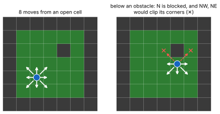

# 1. The problem: mowing a grid

[← index](README.md) · code: [`lawnmower/grid.py`](../lawnmower/grid.py), [`lawnmower/sim.py`](../lawnmower/sim.py)

## The model

The lawn is a grid of square cells. The model rests on one choice: **a cell
is exactly the area the blade cuts**. The mower sits on one cell, mows it on
arrival, and moves to one of its 8 neighbours at each step. A path is
therefore a sequence of cells, and a cell is mowed as soon as the path
visits it.

A diagonal move squeezes between two orthogonal neighbours. It is legal only
if **both** are free, so the mower never clips the corner of an obstacle:



Map files use `L` for lawn, `S` for lawn plus the start, and `+` for an
obstacle. Everything outside the file is an obstacle.

## Which cells can be mowed?

Some lawn may be cut off from the start, for example a patch enclosed by a
hedge. The cells to mow are those the mower can reach. One might expect the
diagonal moves to let the mower slip through more gaps, but the
no-corner-cutting rule prevents it:

> **The cells reachable with the 8 moves are exactly the cells reachable
> with the 4 orthogonal moves.**

*Proof.* Every orthogonal move is one of the 8 moves. Conversely, a legal
diagonal move from $`(r, c)`$ to $`(r+1, c+1)`$ requires $`(r+1, c)`$ to be free,
so it can be replaced by the two orthogonal moves
$`(r, c) \to (r+1, c) \to (r+1, c+1)`$. Any 8-move path therefore becomes a
4-move path between the same cells. ∎

So `Lawn.reachable` is a plain breadth-first search with 4 neighbours, and
lawn outside it is reported as *unreachable* (`maps/maze2.txt` has some).
Below, $`N`$ is the number of reachable cells.

## A graph problem

Let $`G`$ be the graph whose vertices are the $`N`$ reachable cells and whose
edges are the legal moves. Mowing the lawn means finding a **walk in $`G`$
that starts at the start cell and visits every vertex**. A walk may pass
through a vertex several times, and here each extra pass is a wasted move.
The main cost is the number of moves, `steps`.

### The lower bound $`N - 1`$

The mower starts on one cell, and each move reaches at most one new cell.
So **every complete path has at least $`N - 1`$ moves**. More precisely, each
move either reaches a new cell or lands on a mowed one (a *revisit*), so a
complete path has exactly

```math
\text{steps} = (N - 1) + \text{revisits}.
```

A path reaches the bound if and only if it never revisits a cell, that is,
if it is a **Hamiltonian path** of $`G`$ starting at the start cell.

### Why the true optimum is not computed

The shortest complete walk is the true optimum, and the bound is not always
reachable. A dead-end corridor one cell wide forces the mower to come back
over cells it has already mowed. How hard is it to find this optimum?

* With orthogonal moves only, deciding whether a path of $`N - 1`$ moves
  exists is the Hamiltonian path problem on a *grid graph*. Itai,
  Papadimitriou and Szwarcfiter (1982) proved it NP-complete.
* Our graph also has diagonal edges, so that theorem does not apply word for
  word. But the problem keeps the same combinatorial nature. The shortest
  walk visiting all vertices is a travelling salesman problem on the
  shortest-path distances of $`G`$ (the *graphic TSP*), which is NP-hard in
  general. No efficient exact method is known for our grids, and exhaustive
  search is out of the question beyond toy lawns.

The project therefore measures every path against the bound, through

```math
\text{overhead} = \frac{\text{steps}}{N - 1} = 1 + \frac{\text{revisits}}{N - 1}.
```

* overhead = 1.0 means the path is **provably optimal**;
* above 1.0, part of the gap may be unavoidable, so the true distance to the
  optimum is unknown. It is at most overhead − 1.

## Turns

Steps are not the only cost. A real mower slows down and pivots when it
changes direction, and straight parallel stripes look better. The *heading*
is the direction of the last move, one of 8, i.e. a multiple of 45°. A move
in another direction is a *turn*:

* `turns` counts the heading changes;
* `turn_angle` adds up their angles (a U-turn at the end of a pass is two
  90° turns, i.e. 180°);
* `mean_run` = steps / (turns + 1) is the average length of a straight run.

Steps and turns pull in different directions: the shortest path often snakes
around, and the straightest path makes detours. The planners can trade one
for the other with `--turn-weight W`, which compares candidate paths on
steps + W·turns. The learned agent is given the same trade-off through its
rewards ([page 5](05-reinforcement-learning.md)).

## One referee: `evaluate`

Every method, planner or agent, returns a plain list of cells.
`sim.evaluate(lawn, path)` replays it, **raises an error on any illegal
move** (a jump, an obstacle, a clipped corner, a wrong start), and computes
all the metrics:

| metric | definition |
|---|---|
| `coverage` | share of the $`N`$ reachable cells visited |
| `steps` | number of moves |
| `length` | distance travelled, a diagonal counting $`\sqrt 2`$ |
| `turns`, `turn_angle` | heading changes, and their total in degrees |
| `revisits` | moves landing on an already-mowed cell |
| `overhead` | steps / (N − 1) |
| `mean_run` | steps / (turns + 1) |

Since no method computes its own score, the comparisons in the following
pages are fair by construction.

[Next: random walk and greedy →](02-greedy.md)
