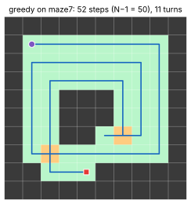

# 2. Local rules: random walk and greedy

[← index](README.md) · code: [`lawnmower/planners/baselines.py`](../lawnmower/planners/baselines.py), [`lawnmower/planners/common.py`](../lawnmower/planners/common.py)

Both planners decide one move at a time, looking only around the mower.
They are the baselines: anything cleverer must do better.

## Random walk

At each step, move to a random *unmowed* neighbour; if there is none, move
to a random neighbour. This is roughly what a cheap "bump-and-turn" robot
mower does.

It starts well, but once the mower is surrounded by mowed grass the rule
becomes a plain random walk, and the last isolated patches are found only by
chance. The expected time for a random walk to visit every vertex (the
*cover time*) grows much faster than $`N`$. On `maze2` (N = 404) the walk
needs 12 721 steps, an overhead of 31.6. It is seeded, and it stops after
50 N steps even if the lawn is not finished.

## Greedy

Greedy keeps the first idea, *prefer unmowed cells*, but chooses among them
deliberately and never wanders. At each step, among the unmowed neighbours,
it picks the first in this order of preference (a lexicographic key):

1. **the cell straight ahead**, to keep the current pass going;
2. **orthogonal before diagonal** moves, since diagonal moves leave
   saw-tooth edges that must be fixed later;
3. **the cell with the fewest unmowed 4-neighbours.** This makes the mower
   hug the boundary of the unmowed area, like mowing a lawn from the
   outside in. A cell with few unmowed neighbours is one that would
   otherwise be left behind as an isolated patch, and fetching an isolated
   patch later costs a round trip;
4. **the smallest turn** from the current heading.

When no neighbour is unmowed, the mower is boxed in by mowed grass. It then
walks to the **nearest unmowed cell** (below) and starts again.



On `maze7` this gives a spiral from the outside in, 52 steps for a bound of
50, with 2 revisits (orange). Greedy's weakness is that it never plans: it
does not see that a pass will end in a dead end, and on large lawns it
leaves unmowed strips that it has to come back for, sometimes from far
away.

## Two searches used by every planner

### The nearest unmowed cell

`nearest_unmowed` runs a breadth-first search from the mower and stops at
the first distance where an unmowed cell appears. BFS explores cells by
increasing number of moves, so the first unmowed cells found are the
closest. If several are equally close, it takes the one whose first move
needs the smallest turn.

### Shortest paths that prefer fewer turns

Every planner moves between distant cells with `Lawn.shortest_path(a, b)`.
On a grid there are usually many shortest paths: a staircase and an L shape
can have the same number of moves. The planner wants the one with the
fewest turns, without giving up a single step.

The number of turns of a path depends on the *direction of the previous
move*, which a cell alone does not record. The search therefore runs on an
enlarged graph whose states are **(cell, heading)** pairs. A move from state
$`(c, h)`$ in direction $`h'`$ costs

```math
\text{cost} = 10\,000 \times 1 \;+\; [\,h' \neq h\,],
```

and Dijkstra's algorithm finds the cheapest path. The weight 10 000 makes
the cost lexicographic: one step always outweighs any number of turns along
the path (paths here are much shorter than 10 000 moves). So the result has
the fewest steps, and among those, the fewest turns.

Enlarging the state to make the cost depend only on the current state is a
classic idea. It comes back on [page 5](05-reinforcement-learning.md), when
the agent is given a "steps since the last turn" channel for the same
reason.

[← The problem](01-problem.md) · [Next: boustrophedon decomposition →](03-boustrophedon.md)
