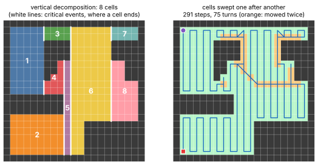
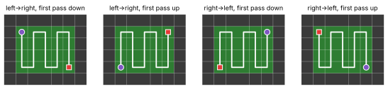

# 3. Boustrophedon cellular decomposition

[← index](README.md) · code: [`lawnmower/planners/boustrophedon.py`](../lawnmower/planners/boustrophedon.py)

*Boustrophedon*, "as the ox turns" in Greek, is the way an ox ploughs a
field: down one furrow, U-turn, up the next. On an open rectangle it is the
obvious way to mow: parallel passes, two turns per pass, no cell mowed
twice. Obstacles break the passes. Choset and Pignon (1997) proposed cutting
the lawn into **cells** in which plain back-and-forth passes work, then
mowing the cells one after another.

## 1. Sweep a line and cut at critical events

Sweep a vertical line across the lawn, column by column. In each column, the
reachable cells form one or more vertical **segments** (maximal runs of
lawn). Moving from one column to the next:

* if a segment overlaps exactly one segment of the previous column, and
  that one overlaps only it, the two belong to the **same cell**: the cell
  goes on;
* otherwise (a segment appears or disappears, one segment splits around an
  obstacle, two segments merge behind it) we are at a **critical event**,
  and a new cell begins.

Inside a cell, consecutive columns overlap one to one, so the cell can be
mowed column after column with vertical passes, moving sideways at the end
of each pass.

On `maze0`, the obstacles create 8 cells (left). Cell 5 is a single column
squeezed between two obstacles, and cells 3 and 7 are short strips along the
top. Each cell is swept on its own (right).

## 2. Sweep a cell

A cell can be swept in **4 ways**: from its left or its right column, with
the first pass going down or up. Each way has its own entry corner (●) and
exit corner (■):

The exit is always in the last column swept. It is at the opposite end
(top or bottom) from the entry when the cell has an odd number of columns,
and at the same end when the number is even. Between two columns the
mower moves to the start of the next segment by a shortest path, which is a
single step when the segments line up.

Each pass ends with a U-turn, two 90° turns. Long passes therefore mean few
turns, and this is where boustrophedon shines.

## 3. Order the cells: a small generalised TSP

Sweeping a cell costs about the same whatever the order. What depends on
the order is the **travel between cells**: from the exit of one to the entry
of the next, over grass already mowed. Choosing the order *and* the way each
cell is swept, to minimise that travel, is a **generalised travelling
salesman problem**: each "city" (cell) comes in 4 versions (entry/exit
pairs), and exactly one version of each city must be visited.

With $`K`$ cells, an exact solution (dynamic programming over subsets) costs
about $`2^K K^2`$ operations, too much beyond a dozen cells. The code uses two
heuristics and keeps the better result:

* **Nearest first.** Repeatedly sweep the unmowed cell whose entry corner is
  closest to the mower. It is quick, but short-sighted: a cell that is close
  now may leave the mower stranded far from everything else.
* **Rollout of nearest first** (`order_cells`). At each decision, *every*
  candidate (cell, way) is tried: its cost is the travel to its entry, plus
  the travel that nearest first would need to finish *all the other cells*
  starting from its exit. The best candidate is kept, and the process is
  repeated. This look-ahead, a classic idea from approximate dynamic
  programming (Bertsekas), avoids the dead ends of plain nearest first. It
  costs about $`O(K^4)`$ distance look-ups ($`K`$ decisions, $`4K`$ candidates
  each, and a nearest-first completion of $`O(K^2)`$ for each), so it is
  used up to 30 cells.

All travel costs are exact grid distances, from one BFS per corner.

## 4. Try both orientations

Vertical passes suit tall cells; horizontal passes suit wide ones. The whole
procedure is run on the lawn and on its transpose (horizontal passes), and
the cheapest of the candidate paths (2 orders × 2 orientations) is kept. On
`maze0`, the vertical version in the figure takes 291 steps and 75 turns;
the horizontal one takes 282 steps and 52 turns, and that is the one the
planner returns.

## Strengths and weaknesses

* **Few turns**: on the example maps, boustrophedon gives by far the
  straightest paths (71 turns on `maze2`, against 133 for greedy and 182
  for STC).
* **Wasted travel**: getting from one cell to the next means crossing mowed
  grass, and narrow cells (a single column, like cell 5) cost two turns per
  cell. When obstacles are many and small, the lawn breaks into many
  small cells and the method loses its advantage (`test_map`).
* On an open rectangle, it is exact: N − 1 steps, no revisit.

[← Random walk and greedy](02-greedy.md) · [Next: Spanning Tree Coverage →](04-stc.md)
