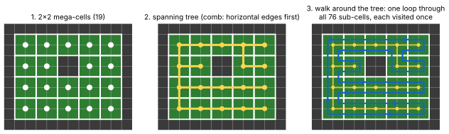
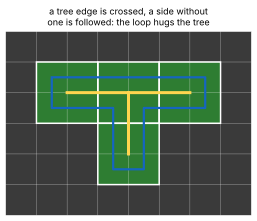

# 4. Spanning Tree Coverage

[← index](README.md) · code: [`lawnmower/planners/stc.py`](../lawnmower/planners/stc.py)

Gabriely and Rimon (2001) found a remarkably simple way to visit every cell
of a region **exactly once**: group the cells into 2×2 blocks, connect the
blocks with a spanning tree, and walk around the tree, as one would walk
around a hedge keeping a hand on it.

## 1. Mega-cells

Group the grid into 2×2 **mega-cells**. A mega-cell is kept if its 4
sub-cells are all reachable lawn. Two kept mega-cells sharing a side are
neighbours: this gives a graph of mega-cells.

The grid can be cut into 2×2 blocks in 4 ways (an offset of 0 or 1 in each
direction). The code tries all 4.

## 2. A spanning tree

A **spanning tree** of the mega-cell graph connects all mega-cells with
exactly $`M - 1`$ edges ($`M`$ mega-cells), without cycles. Any spanning tree
works for coverage. Its shape decides how straight the path is.

The code builds it with Kruskal's algorithm, which adds the edges in order
and skips any that would close a cycle. All edges along one axis
(horizontal, say) are listed first, so the tree takes every horizontal edge
it can and only uses vertical edges to connect the rows. The result is a
**comb**: long horizontal branches, joined by a few vertical ones. Both
combs, horizontal and vertical, are tried.

## 3. Walk around the tree

The figure shows the three stages on a small lawn with one obstacle:

The loop is built locally, sub-cell by sub-cell. Each sub-cell touches two
sides of its mega-cell (the top-left sub-cell touches the top side and the
left side). For each of these two sides:

* if a **tree edge crosses that side**, link the sub-cell to the sub-cell
  facing it in the neighbouring mega-cell (the loop crosses over, next to
  the edge);
* otherwise, link it to its **sibling along that side**, in the same
  mega-cell (the loop follows the side, where no branch leaves).

### Why this gives one loop visiting every sub-cell once

1. **The links are symmetric.** If a sub-cell links across a side because a
   tree edge crosses it, the facing sub-cell sees the same edge on its side,
   and links back. If it links to its sibling because no edge crosses that
   side, the sibling touches the same side, sees no edge, and links back.
2. **Every sub-cell has exactly two links**, one per side it touches. A
   graph where every vertex has degree 2 is a disjoint union of cycles.
3. **There is only one cycle per tree.** Draw the tree as a thick band, one
   mega-cell wide. Since the tree is connected and has no cycle, this band
   has no hole: its boundary is a single closed curve. The loop runs along
   the inside of this boundary, half a mega-cell from the tree, so it too is
   a single closed curve.

So the loop passes through all $`4M`$ sub-cells, each exactly once, with
orthogonal moves only. It is a **Hamiltonian cycle** of the covered part of
the lawn. The code checks this (`circumnavigate` raises an error if a
sub-cell is met twice), and so do the tests.

Starting from any cell of the loop and following it, the mower mows the
$`4M`$ cells in $`4M - 1`$ moves: the lower bound of [page 1](01-problem.md),
on that part of the lawn. If the mega-cells cover the whole lawn (an open
rectangle with even sides, for instance), STC is **provably optimal**.

## 4. The leftovers

Lawn the mega-cells do not cover must still be mowed: strips of odd width,
and the edges of obstacles that do not line up with the 2×2 grid. The
planner mows them in two ways:

* **detours**: while walking the loop, when the mower passes next to a
  leftover cell, it steps into it and follows the chain of leftover cells,
  stopping when the next one is also next to a part of the loop still to
  come (that one will be picked up later, almost for free);
* a final **clean-up**: whatever is still unmowed at the end is reached with
  nearest-first moves.

If the lawn has several separate groups of mega-cells (a forest rather than
a tree), each gives its own loop, and the mower goes from loop to loop,
entering each at its closest cell.

The 4 offsets × 2 comb directions give 8 candidate paths, and the cheapest
is kept.

## Strengths and weaknesses

* **Fewest wasted moves on blocky lawns**: on `maze2` and `maze8`, STC has
  the fewest steps of the three planners (427 and 420 for bounds of 403 and
  405), with very few revisits (24 and 15).
* **Many turns**: the loop moves only orthogonally, and it turns at the end
  of every branch and at every junction of the tree, plus around each
  leftover detour. That makes 182 turns on `maze2`, more than twice as many
  as boustrophedon.
* **Weak on fragmented lawns**: with many small obstacles, few 2×2 blocks
  fit, leftovers dominate, and the method degrades into its clean-up rule
  (`test_map`: 478 steps against 440 for greedy).

[← Boustrophedon decomposition](03-boustrophedon.md) · [Next: reinforcement learning →](05-reinforcement-learning.md)
