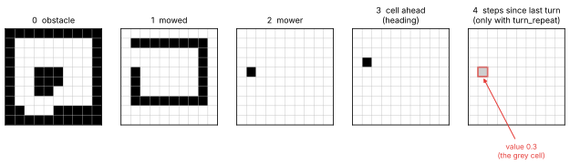
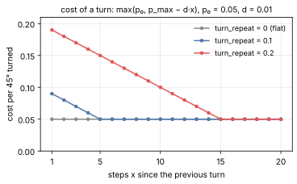

# 5. Reinforcement learning

[← index](README.md) · code: [`lawnmower/rl.py`](../lawnmower/rl.py), [`lawnmower/learn/ppo.py`](../lawnmower/learn/ppo.py), [`lawnmower/lawngen.py`](../lawnmower/lawngen.py)

The planners of pages 2–4 are rules designed by hand. Reinforcement
learning lets an agent find its own rule by trial and error, from a single
signal, the *reward*. The goal is not one path for one lawn, but a
**policy**, a rule that chooses a good move on any lawn.

## Mowing as a Markov decision process

A Markov decision process (MDP) has states $`s`$, actions $`a`$, a transition
from $`(s_t, a_t)`$ to $`s_{t+1}`$, and a reward $`r_t`$. For the mower:

* **state**: the lawn, the set of mowed cells, the mower's position and
  heading;
* **actions**: the 8 moves. An illegal move leaves the mower in place and
  costs a penalty; the training uses an *action mask* so it never happens;
* **transition**: deterministic: the same move from the same state always
  gives the same next state;
* **end**: the episode *terminates* when every reachable cell is mowed, and
  is *truncated* (cut off) after $`4N`$ moves.

The agent maximises the expected **discounted return**

```math
G_t = r_t + \gamma\, r_{t+1} + \gamma^2 r_{t+2} + \dots, \qquad \gamma = 0.995 .
```

Two functions summarise a policy $`\pi`$: the **value**
$`V^\pi(s) = \mathbb E_\pi[G_t \mid s_t = s]`$, the return expected from a
state, and the **advantage**
$`A^\pi(s, a) = \mathbb E[r_t + \gamma V^\pi(s_{t+1}) \mid s, a] - V^\pi(s)`$,
how much better a move is than the policy's average move in that state.

### What the agent sees

The observation is a stack of grids the size of the lawn, one per piece of
information:



Channel 3 marks the cell straight ahead, which encodes the heading in the
picture itself. Channel 4 is only present when the consecutive-turn penalty
is used (see below). The observation contains the whole state, so the agent
sees everything that matters.

## Rewards: telling the agent what a good path is

| event | reward |
|---|---:|
| reaching an unmowed cell | +1 |
| every move | −0.1 |
| turning, per 45° | −0.05 |
| illegal move | −1 |
| finishing the lawn | +10 |

What does the agent optimise? Take a complete episode of $`S`$ moves, with
turns of $`k_1, k_2, \dots`$ times 45°, and ignore discounting ($`\gamma \approx 1`$):

```math
G = \underbrace{(N - 1) + 10}_{\text{the same for every complete path}} \;-\; 0.1\,\Big(S + \tfrac{0.05}{0.1} \sum_i k_i\Big).
```

**Maximising the return is minimising `steps` + ½ × (number of 45° turns).**
The rewards are a cost function in disguise: a 90° turn ($`k = 2`$) costs as
much as one step. Changing the turn penalty $`p`$ changes the exchange rate,
$`2p/0.1`$ steps per 90° turn. With $`p = 0.01`$ a U-turn costs less than half a
step and the agent snakes; with $`p = 0.05`$ it prefers longer straight passes.

The other rewards do not change which complete path is best, but they make
learning possible:

* the **+1 per new cell** gives an immediate signal at every useful move,
  instead of only at the end (*reward shaping*);
* the **+10 at the end** makes the last isolated cells worth fetching;
* **discounting** ($`\gamma < 1`$) weights distant rewards less:
  $`0.995^{200} \approx 0.37`$. It adds a mild preference for mowing new cells
  soon, and it makes distant unmowed patches look less valuable on large
  lawns.

### Penalising consecutive turns

Snaking is made of turns close together: zigzags, and U-turns at the ends of
short stripes. With `--turn-repeat`, a turn made $`x`$ steps after the
previous one costs, per 45°,

```math
\max(p_0,\; p_{\max} - d\,x), \qquad p_0 = 0.05,\; d = 0.01,
```

so a turn right after another costs up to twice ($`p_{\max} = 0.1`$) or four
times ($`p_{\max} = 0.2`$) the base price, and the surcharge fades with the
distance:



## The Markov property, and the 5th channel

An MDP has the **Markov property**: the next state and the reward depend on
the current state and action only,

```math
P(s_{t+1}, r_t \mid s_t, a_t, s_{t-1}, a_{t-1}, \dots) = P(s_{t+1}, r_t \mid s_t, a_t).
```

The whole theory (value functions, the Bellman equation, policy gradients)
rests on it. With the consecutive-turn penalty, the reward of a turn depends
on $`x`$, the number of steps since the previous turn, and the four channels
do not show $`x`$. Two situations that look identical to the agent then give
different rewards for the same move: turning costs 0.09 one step after a
turn, 0.05 ten steps after.

The consequences are concrete:

* the **value head** must predict one number for situations it cannot tell
  apart, so it predicts their average. Its error never goes away, and it
  becomes noise in the advantages, so learning is slower and less stable;
* the **policy** cannot avoid a cost it cannot see: it cannot "wait a few
  steps before turning again".

The fix is the one used for shortest paths on [page 2](02-greedy.md):
**enlarge the state** so that it contains what the cost depends on. Channel
4 holds, at the mower's cell, $`\min(x, K) / K`$. The cap $`K`$ must be at least
the number of steps the surcharge takes to fade ($`(p_{\max} - p_0) / d`$:
5 steps for $`p_{\max} = 0.1`$, 15 for $`0.2`$; the code uses
$`K = \max(10, \text{that})`$), otherwise turns made 11 and 14 steps after the
previous one would look the same but cost differently. The rule is general:
**if the reward depends on something, the agent must be able to observe
it.**

## Learning the policy

The network (next page) has two outputs: the **policy** $`\pi_\theta(a \mid s)`$,
a probability for each of the 8 moves, and the **value** $`V_\theta(s)`$.
Training has two phases.

### Phase 1: behaviour cloning

A random policy almost never finishes a lawn, so it would take PPO a long
time to discover what a complete path looks like. The network is therefore
first trained to **imitate a planner**: the greedy planner mows 500 lawns,
every (observation, move) pair is recorded, and the policy is trained as a
classifier (cross-entropy) to predict the planner's move. Greedy is the
easiest teacher to imitate, because its rule only looks at the mower's
surroundings: the network reproduces about 97% of its moves. PPO starts from
a policy that already finishes lawns, and then improves on its teacher.

### Phase 2: PPO

The **policy gradient theorem** gives the direction that increases the
expected return:

```math
\nabla_\theta J = \mathbb E\big[\nabla_\theta \log \pi_\theta(a_t \mid s_t)\; A(s_t, a_t)\big]:
```

make moves that turned out better than average (positive advantage) more
likely, and the others less likely. Three ingredients make this work in
practice.

**Estimating the advantage (GAE).** The value head gives a one-step
estimate, the TD error $`\delta_t = r_t + \gamma V(s_{t+1}) - V(s_t)`$.
Generalised advantage estimation (Schulman et al., 2016) averages the
estimates over all horizons:

```math
\hat A_t = \sum_{l \ge 0} (\gamma\lambda)^l\, \delta_{t+l}, \qquad \lambda = 0.95 .
```

$`\lambda = 0`$ trusts the value head entirely (low variance, biased if $`V`$ is
wrong); $`\lambda = 1`$ uses the observed rewards only (unbiased, high
variance). The value head is trained to predict $`\hat A_t + V(s_t)`$.

**Not changing the policy too much (clipping).** Collecting experience is
expensive, so each batch is used for several passes of gradient descent. To
avoid moving the policy far from the one that collected the data, PPO
(Schulman et al., 2017) maximises the *clipped* objective

```math
L(\theta) = \mathbb E\Big[\min\big(\rho_t \hat A_t,\; \operatorname{clip}(\rho_t, 1-\varepsilon, 1+\varepsilon)\, \hat A_t\big)\Big],
\qquad \rho_t = \frac{\pi_\theta(a_t \mid s_t)}{\pi_{\text{old}}(a_t \mid s_t)},\; \varepsilon = 0.2 .
```

Once the probability of a move has moved by more than 20% in the direction
its advantage favours (up for a good move, down for a bad one), that sample
stops pushing it further. The total loss also contains the value error
($`0.5 \times`$ MSE) and an **entropy bonus** ($`0.01 \times`$ entropy) that
keeps the policy from becoming deterministic too early.

**Episodes that are cut, not finished.** An episode truncated after $`4N`$
moves did not end: the mower could go on. Treating its last state as final
(future return 0) would teach the value head something false. The code
*bootstraps* instead: it adds $`\gamma V(s_{\text{last}})`$ to the last reward.

The settings (`PPOConfig`):

| | |
|---|---|
| parallel environments × steps per batch | 32 × 128 = 4 096 moves |
| passes over each batch, minibatches | 4 epochs, 4 minibatches of 1 024 |
| learning rate | 3·10⁻⁴, decreasing linearly to 0 |
| γ, λ, ε | 0.995, 0.95, 0.2 |
| reward scale | ×0.1 (keeps returns of the order of 10 for the value head) |
| gradient norm clipping | 0.5 |

Illegal moves get a logit of −10⁹, i.e. probability 0. They are never
sampled and the policy never has to learn to avoid them.

## Where the training lawns come from

The agent should mow lawns it has never seen, so every episode is a **new
lawn**:

* a **random garden** (`lawngen.random_lawn`): a walled rectangle, with
  corners cut off (L, T or U shapes) and rectangular obstacles (flower beds,
  sheds); lawn not connected to the main area is turned into obstacle;
* or one of the small **example maps**, from a random start cell.

Two cheap ways to get more out of this:

* **symmetries**: each lawn is rotated by 0, 90, 180 or 270° and possibly
  mirrored (the 8 symmetries of the square). Mowing a lawn and its mirror
  image are the same problem, so each map counts as 8;
* **curriculum** (`--curriculum 0.3`): the random gardens start at the
  smallest size and grow to the largest over the first 30% of the training,
  so the agent learns to
  finish small lawns before facing large ones.

Lawns of different sizes are padded to a common size so that they can be
batched; the padding is marked as obstacle, so it looks like a wall.

## Using the trained agent

`python -m lawnmower run -p agent` mows with the policy. Taking the most
likely move every time gives one path; sampling the moves from the policy
16 times and keeping the shortest complete path is a cheap search that is
usually better. In both cases the path goes through `evaluate` like any
planner's. Results, and the question of generalising versus specialising on
one map, are in the main README.

[← Spanning Tree Coverage](04-stc.md) · [Next: the network →](06-network.md)
