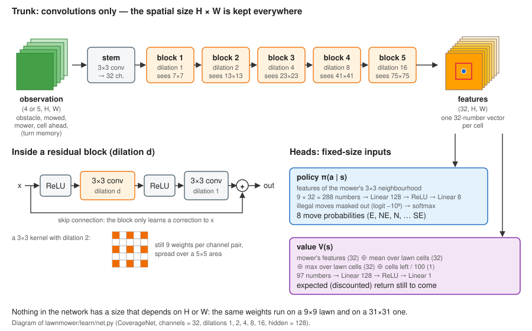
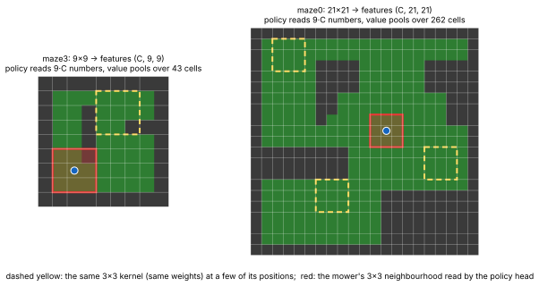
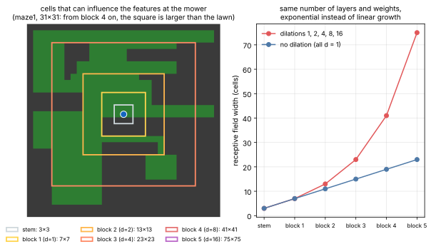

# 6. The network: one set of weights for every lawn size

[← index](README.md) · code: [`lawnmower/learn/net.py`](../lawnmower/learn/net.py)

The agent of [page 5](05-reinforcement-learning.md) is trained on gardens of
8×8 to 14×14 cells and then run on maps of 21×21 or 31×31. A typical image
network could not do that: its last layers expect one fixed input size. This
page shows how `CoverageNet` is built so that **the same weights work on a
lawn of any size**, and what that does and does not guarantee.



## Convolutions do not care about the size

A 3×3 convolution computes, at every cell $(i, j)$ and for every output
channel $c'$,

```math
y_{c'}(i, j) = b_{c'} + \sum_{c} \sum_{u, v \in \{-1, 0, 1\}} W_{c', c, u, v}\; x_c(i + d\,u,\; j + d\,v),
```

where $d$ is the dilation (1 for an ordinary convolution). The weights $W$
form a small fixed array, 3 × 3 × (input channels) × (output channels),
**shared by every cell**: the same kernel slides over the whole grid. Nothing
in $W$ depends on the height $H$ or the width $W$ of the lawn. A bigger lawn
means more positions to slide over, not more weights. The output keeps the
size of the input (zero padding at the borders, no stride, no pooling), so
after the trunk every cell has its own vector of 32 features.

Sliding the same kernel everywhere has a second consequence: the network
has no notion of absolute position. If the lawn is shifted by a few cells,
the features shift with it (*translation equivariance*). The agent reacts to
what is around the mower, not to where the mower is.



## What would tie a network to one size

Most image classifiers end with a `Flatten → Linear` layer: the whole
feature map, $C \cdot H \cdot W$ numbers, is multiplied by a weight matrix.
That matrix has one column per input number, so its shape *is* the input
size. For our 32 channels and a hidden layer of 128:

| lawn | weights of one `Flatten → Linear(128)` layer |
|---|---:|
| 9×9 | 331 776 |
| 14×14 | 802 816 |
| 31×31 | 3 936 256 |

A network trained on 14×14 lawns could not even be *run* on a 31×31 one.
The whole `CoverageNet` has **144 361** parameters, whatever the lawn size.
Both heads avoid flattening the map:

* the **policy head** reads only the features of the **3×3 neighbourhood of
  the mower**, i.e. of the 8 cells it can move to plus its own: always
  9 × 32 = 288 numbers. The mower's position is found as the maximum of
  channel 2 of the observation. Each of the 8 moves gets a score (logit);
* the **value head** reads the mower's own features (32), plus the **mean
  and the maximum of each feature over all lawn cells** (2 × 32), plus the
  number of cells left (÷ 100): always 97 numbers. Pooling over the lawn
  turns a map of any size into a fixed-size summary. The mean says how much
  of something there is; the maximum says whether it exists anywhere (an
  unmowed island, for example).

| part | parameters |
|---|---:|
| stem (3×3 conv, 4 → 32 channels) | 1 184 |
| trunk (5 residual blocks) | 92 480 |
| policy head | 38 024 |
| value head | 12 673 |
| **total** | **144 361** |

## Seeing far: dilated convolutions

The policy only reads the mower's neighbourhood. To choose well, the
features there must summarise what lies further away: an unmowed strip
behind a wall, a dead end ahead. The **receptive field** of a feature is the
set of input cells that can influence it.

Each 3×3 convolution with dilation $d$ extends the receptive field by $d$
cells in every direction. A residual block has one dilated convolution and
one ordinary one, so with $r_k$ the radius after block $k$:

```math
r_0 = 1 \;(\text{stem}), \qquad r_k = r_{k-1} + d_k + 1 .
```

With the dilations 1, 2, 4, 8, 16 this gives radii 1, 3, 6, 11, 20, 37,
i.e. widths 3, 7, 13, 23, 41, **75** cells. Without dilation, the same 5
blocks would reach only 23 cells. The number of weights is the same in both
cases: a dilated kernel still has 9 taps, just spread out.



A dilated convolution alone sees a sparse grid of cells, and stacking them
carelessly leaves holes (*gridding*). Here, before the block with dilation
$d$, the receptive field already has a width $2r + 1 \ge d$, so the three
spread-out taps overlap and the field stays a full square. The figure script
checks this by propagating the actual kernel offsets
([`tools/make_figures.py`](../tools/make_figures.py), `receptive_radii`).

**Residual blocks** (He et al., 2016) add each block's input to its output.
Each block learns a correction rather than a whole new representation, which
keeps a 10-layer trunk easy to train.

## Able to run is not trained to run

On a 31×31 lawn, the receptive field (75 cells) covers the whole lawn from
any cell. So the network *can* see everything. That does not mean it has
*learned* to use what it sees:

* an agent trained on lawns of at most 14×14 has never had to go and fetch
  grass 25 cells away; the features that would encode such distances were
  never trained;
* the value head's inputs leave the range seen in training: at the start of
  `maze1`, "cells left / 100" is 4.25, while the largest training lawns
  give at most about 1.4. The value estimate there is an extrapolation.
* the receptive field is an upper bound: in practice, the influence of a
  cell decreases quickly with its distance from the centre (the *effective*
  receptive field is much smaller; Luo et al., 2016).

The sampled agent still finishes every large map, and on several of them it
beats the planners, but its uncertain value estimates are what makes the
search of the [next page](07-mcts.md) hit-or-miss on large maps. The fix is
not a different architecture but **training on large lawns** (the Kaggle
notebook in `tools/` does it on a GPU).

[← Reinforcement learning](05-reinforcement-learning.md) · [Next: single-player MCTS →](07-mcts.md)
