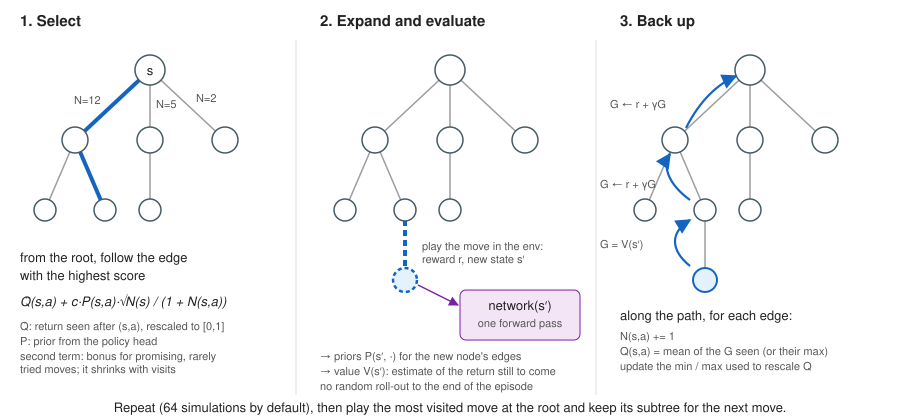

# 7. Searching with the network: single-player MCTS

[← index](README.md) · code: [`lawnmower/learn/mcts.py`](../lawnmower/learn/mcts.py)

The trained policy chooses each move in one glance. **Monte Carlo Tree
Search** (MCTS) spends more computation per move: before each move it
*imagines* many possible continuations, guided by the network, and plays the
move whose continuations looked best. This is what AlphaZero does in chess
and Go (Silver et al., 2018). Mowing differs from those games in one
important way: **there is no opponent**.

## The search tree

The nodes are states, the edges are moves. Each edge $(s, a)$ stores

* $P(s, a)$, the **prior**: the probability the policy head gives to $a$;
* $N(s, a)$, the number of simulations that went through it;
* $Q(s, a)$, the return observed after it (the mean, or the best, of the
  returns backed up through it);
* the reward of the move.

Before each real move, the search runs a number of **simulations** (64 by
default). Each one has three stages:



### 1. Select

Starting at the root, follow at each node the edge with the highest score
(the *PUCT* rule):

```math
a^* = \arg\max_a \; \hat Q(s, a) + c\; P(s, a)\, \frac{\sqrt{N(s) + 1}}{1 + N(s, a)},
\qquad c = 1.25,
```

where $N(s)$ is the total number of visits of the node. The first term is
**exploitation**: moves that gave good returns. The second is
**exploration**: a bonus for moves the policy finds promising (large $P$)
but that have been tried little (small $N(s, a)$). The bonus shrinks as a
move is visited, so the search gradually concentrates on the best moves,
while every move with a non-zero prior is eventually tried.

An edge never visited has no $Q$ yet; it starts at the value of its node
(*first-play urgency*), so it is neither preferred nor ignored.

### 2. Expand and evaluate

When the selection reaches an edge never taken, the move is played in a copy
of the environment, giving its reward $r$ and a new state $s'$. The network
is run **once** on $s'$:

* the policy head gives the priors of the new node's edges;
* the value head gives $V(s')$, an estimate of the return still to come.

The classical MCTS would instead play random moves to the end of the
episode (a *roll-out*) to estimate the return. On a 400-cell lawn a random
roll-out would take thousands of moves and say little; the value head
answers in one forward pass.

### 3. Back up

The estimate is carried back up the path, discounting it at each step:

```math
G \leftarrow V(s'), \qquad \text{then for each edge from the leaf to the root:}\quad G \leftarrow r + \gamma\, G,
```

and each edge on the path adds 1 to its count $N$ and updates its $Q$.

After the simulations, the mower plays the **most visited** move at the
root. The visit count is a more robust choice than the highest $Q$: a move
visited often has been checked many times.

## What changes when there is no opponent

1. **No alternation.** In a two-player game, the selection maximises the
   value at the player's nodes and minimises it at the opponent's (or flips
   the sign at every level). Here every node maximises the same return.
2. **Unbounded returns.** In a game the outcome is −1, 0 or +1, so $Q$ and
   the exploration bonus have comparable scales. Here returns grow with the
   lawn, and $c = 1.25$ would mean nothing next to a $Q$ of 30. As in MuZero
   (Schrittwieser et al., 2020), $Q$ is rescaled to $[0, 1]$ with the
   smallest and largest values seen in the tree:
   $\hat Q = (Q - Q_{\min}) / (Q_{\max} - Q_{\min})$. The bounds are reset
   before every move, since the returns shrink as the lawn gets mowed.
3. **A deterministic world.** The same moves always lead to the same state,
   so the tree is an exact model of the future. Two consequences:
   * the subtree below the move played is **kept** for the next move, with
     all its statistics;
   * a move can be valued by the **best** return found below it instead of
     the mean (`--backup max`, the idea of single-player MCTS, Schadd et
     al., 2008). In a game, the best line may be refuted by the opponent; in
     a deterministic puzzle, a line found once can be played again. The
     catch: the backed-up returns are partly estimates of the value head,
     and the maximum of several noisy estimates is biased upwards. The mean
     averages the errors out; the max chases them. Here the mean has worked
     better (277 vs 284 steps on `maze0` with an earlier model).

## Cost, and when it pays off

Each simulation costs one network evaluation, so 64 simulations make a move
about 64 times slower than the plain policy: tens of thousands of forward
passes for a large lawn.

A search is only as good as its value estimates. With the small agent,
trained on lawns up to 14×14 (see [page 6](06-network.md)), MCTS mostly
matches the best of 16 sampled episodes on the lawns it knows, finds the
shortest path of all on `maze6`, but fails to finish `maze1` and `test_map`,
where its value estimates are extrapolations. MCTS should pay off with a
network trained on large lawns.

[← The network](06-network.md) · [Back to the index](README.md)
